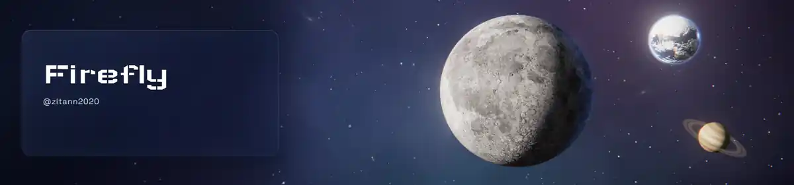

  

I build small tools for Windows.

## Tech Stack

  

## OSS

| Project | What I did |
|---|---|
| ⚙️ **[effectcraft](https://github.com/storytold/effectcraft)** | Japanese UI localization — merged PRs covering menu wording and the effects the Japanese catalog was missing |
| 🧪 **[craft-anything](https://github.com/storytold/craft-anything)** | Added the Japanese UI and the Japanese README |

---

Moon and Earth imagery: NASA (public domain). Rendered in Three.js.
